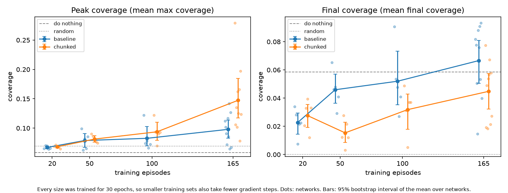
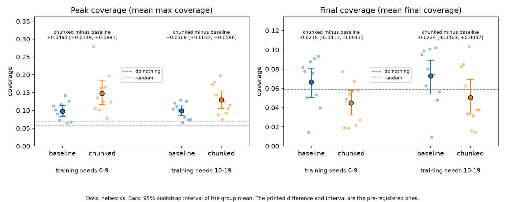
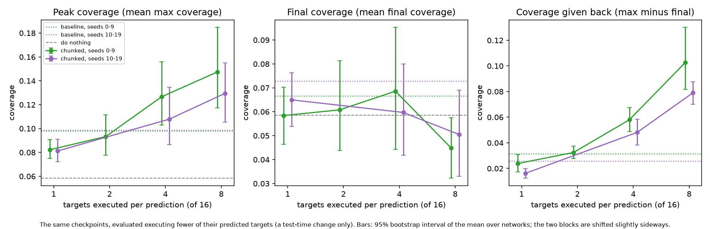
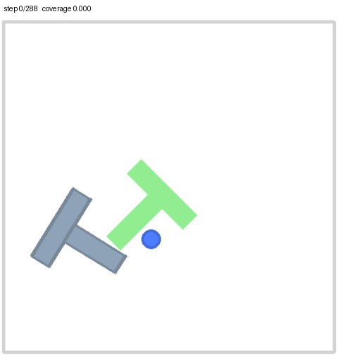
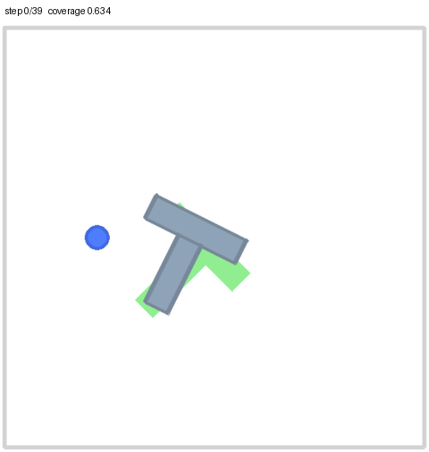
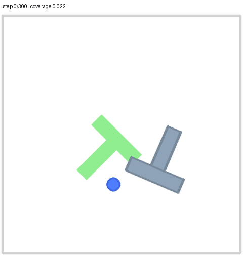

# Imitation learning on PushT in simulation (PyTorch)

**Status: work in progress (last updated 2026-10-22).** Everything below is measured and can be reproduced from this repo; what is not done is listed under "Not done yet". No policy here solves the task reliably: every evaluation scores 0 successes in 50 episodes except two, in which one single episode was solved (by the baseline and the chunked network of training seed 11 in the replication).

## What this is

I am training imitation-learning policies for the simulated PushT task (a 2D pusher moves a T-shaped block onto a fixed T-shaped target) in plain PyTorch, evaluating them over many seeds with the protocol below, and trying to explain how they fail.

The demonstrations are not mine. They are the public `lerobot/pusht` dataset (206 episodes, 25,650 frames, 10 fps, MIT license, from the Diffusion Policy work of Chi et al.), which is described in the benchmark literature as human demonstrations. I use it pinned to revision `7628202a2180972f291ba1bc6723834921e72c19`. The dataset stores a 96x96 image and the agent's 2-number position for each frame, but not the block's pose.

## Setup

- Machine: Windows desktop, WSL2 Ubuntu 24.04, RTX 5070 (12 GB).
- Versions: Python 3.12.3, PyTorch 2.14.1+cu132, torchvision 0.29.1+cu132, numpy 2.5.2, gymnasium 1.4.0, gym-pusht 0.1.6, pymunk 6.11.1 (gym-pusht 0.1.6 breaks on pymunk 7). Full pins are in `requirements-lock.txt`.
- Verified on 2026-10-22: a fresh clone at commit `d7c3149` and a new venv installed from `requirements-lock.txt` (the command under "Reproduce") gave exactly the pinned packages (the lock file and `pip freeze` are identical), `check_env.py` passed on the RTX 5070, the test suite gave 895 passed and 15 skipped (the 15 need trained checkpoints, which are not in the repository), the regenerated random and do-nothing reports and dataset statistics were byte-identical to the committed ones, and re-evaluating two checkpoints (training seed 11 of both methods) reproduced their saved evaluations with zero differing episodes. Most wheels came from the machine's pip cache, so this does not test that every pinned file is still downloadable. Retraining was not tested.

## Policies

- **Baseline (`train_bc.py`)**: a small CNN (4 convolutions, then 3 fully connected layers; 718,178 parameters) from the 96x96 image and the agent's position to one commanded target position, trained with mean squared error and Adam (lr 1e-3, batch 256, 30 epochs, about one minute on the RTX 5070). The split is by whole episodes: 165 for training (20,684 frames), 41 held out (4,966 frames). The checkpoint is always the last epoch; no epoch is selected on validation data.
- **Action-chunking network (`train_chunk.py`)**: the same trunk with a last layer that predicts the next 16 commanded targets (725,888 parameters), trained on the same split with a loss that ignores positions padded past an episode's end. At run time it executes 8 of the 16 targets before predicting again (the number executed can be changed at test time; see the executed-targets study). The 16 and 8 are taken from my memory of the Diffusion Policy PushT setup and have not been checked or tuned.
- **Reference policies**: a random policy and a "do nothing" policy that commands the agent's current position.
- Twenty training seeds (0 to 19) of each network type were trained with identical settings: seeds 0 to 9 form the seed study and seeds 10 to 19 the pre-registered replication. For the demonstration-count ablation, five training seeds of each type were also trained on random subsets of 20, 50 and 100 of the 165 training episodes (same recipe, 30 epochs). For the executed-targets study, the chunked checkpoints were evaluated again executing 4, 2 and 1 (seeds 0 to 9) or 4 and 1 (seeds 10 to 19) of their 16 predicted targets per prediction (a test-time change only; nothing was retrained).

## Evaluation protocol (fixed before any policy was evaluated)

- 50 episodes per policy on seeds 10000 to 10049, the same seeds for every policy, 300 steps maximum per episode.
- Primary metric: mean over episodes of the maximum target coverage reached, with a bootstrap 95% confidence interval (10,000 resamples).
- Also reported: success (the environment's own flag, coverage above 0.95 at any step) with a Wilson 95% interval, and the mean final coverage.
- Reference numbers added after seeing the random baseline, which change no definition above: the coverage right after reset (start coverage), the gain of the maximum over it, and the do-nothing policy. Doing nothing scores exactly the start coverage (mean 0.0585 on these seeds), because the block can start partly on the target.
- Stored coverage values are rounded to 9 decimals. This was added after seeing last-bit differences (5.55e-17) in the simulator's coverage between runs with identical states and actions. Success always comes from the environment's flag.
- Every reported evaluation was run twice in separate processes and counts as reproduced only if all 50 episodes agree on steps and success and to within 1e-6 on coverage. All 122 evaluations reported here (the two reference policies, 20 full-data networks of the seed study and 20 of the replication, 30 ablation networks, and 50 executed-targets evaluations) were reproduced with zero differences.

## Results, training seeds 0 to 2 (50 episodes each, seeds 10000 to 10049)

| Policy | Mean max coverage [95% CI] | Mean final coverage | Mean gain over start | Success |
|---|---|---|---|---|
| Random | 0.0696 [0.0340, 0.1107] | 0.0000 | +0.0111 | 0/50 |
| Do nothing | 0.0585 [0.0261, 0.0973] | 0.0585 | +0.0000 | 0/50 |
| Baseline, training seed 0 | 0.1123 [0.0598, 0.1726] | 0.0818 | +0.0538 | 0/50 |
| Baseline, training seed 1 | 0.1016 [0.0561, 0.1529] | 0.0777 | +0.0431 | 0/50 |
| Baseline, training seed 2 | 0.0907 [0.0510, 0.1352] | 0.0504 | +0.0322 | 0/50 |
| Chunked, training seed 0 | 0.2790 [0.2050, 0.3554] | 0.0775 | +0.2205 | 0/50 |
| Chunked, training seed 1 | 0.1061 [0.0620, 0.1554] | 0.0192 | +0.0477 | 0/50 |
| Chunked, training seed 2 | 0.1352 [0.0864, 0.1884] | 0.0489 | +0.0767 | 0/50 |

The success rate cannot separate anything: even 0 of 50 has a 95% interval reaching 7.1%. Seeds 3 to 9 are in the seed study below.

**Pre-registered three-seed comparison of the chunked network with the baseline.** Criterion, fixed before any chunked policy was evaluated in the simulator: chunking counts as an improvement only if, for each of 3 training seeds, its mean final coverage and its mean max coverage both exceed those of the baseline trained with the same seed. Result: **not met (0 of 3 pairs improved on both metrics).** Differences are chunked minus baseline, with paired bootstrap 95% intervals over the 50 starting positions:

| Training seed | Max coverage | Final coverage |
|---|---|---|
| 0 | +0.1667 [+0.0910, +0.2424] | -0.0043 [-0.0581, +0.0516] |
| 1 | +0.0045 [-0.0388, +0.0468] | -0.0585 [-0.1005, -0.0217] |
| 2 | +0.0445 [+0.0043, +0.0900] | -0.0015 [-0.0413, +0.0393] |

With three networks per group this comparison could not separate a method effect from training noise, which is what the seed study below addresses.

## Seed study (pre-registered): ten training seeds per method

The analysis was fixed before training seeds 3 to 9 were trained (seeds 0 to 2 had already been evaluated, and the design was informed by them). The unit is the network. For each of mean max coverage and mean final coverage: the difference between the two methods' group means (chunked minus baseline), with a 95% bootstrap interval that resamples the 10 networks of each group (10,000 resamples). Verdict: "supported" if both intervals lie entirely above zero, "contradicted" if either lies entirely below zero, otherwise "inconclusive". No network was added, dropped or retrained after its results were seen.

| | Baseline (10 networks) | Chunked (10 networks) | Chunked minus baseline [95% CI] |
|---|---|---|---|
| Mean max coverage | 0.0979 (range 0.0772) | 0.1474 (range 0.2009) | +0.0495 [+0.0149, +0.0891] |
| Mean final coverage | 0.0666 (range 0.0787) | 0.0448 (range 0.0591) | -0.0218 [-0.0411, -0.0017] |

**Verdict: contradicted.** The final-coverage interval lies entirely below zero, so by the rule fixed in advance the claim that chunking is an improvement is contradicted. What the data show is more specific: the chunked networks reach a higher peak coverage (that interval lies entirely above zero) and finish lower. The final-coverage interval ends only 0.0017 below zero, so the contradiction is weak; it does not hold on the seven later networks alone (see the robustness check below), and the replication below, on ten new networks, gave an inconclusive verdict with the same point estimate.

Per network (mean over the 50 episodes):

| Training seed | Baseline max | Chunked max | Baseline final | Chunked final |
|---|---|---|---|---|
| 0 | 0.1123 | 0.2790 | 0.0818 | 0.0775 |
| 1 | 0.1016 | 0.1061 | 0.0777 | 0.0192 |
| 2 | 0.0907 | 0.1352 | 0.0504 | 0.0489 |
| 3 | 0.0719 | 0.1018 | 0.0146 | 0.0184 |
| 4 | 0.1171 | 0.1622 | 0.0880 | 0.0537 |
| 5 | 0.0854 | 0.1251 | 0.0759 | 0.0566 |
| 6 | 0.1418 | 0.1656 | 0.0909 | 0.0673 |
| 7 | 0.0646 | 0.0781 | 0.0533 | 0.0214 |
| 8 | 0.1267 | 0.1971 | 0.0932 | 0.0579 |
| 9 | 0.0673 | 0.1238 | 0.0399 | 0.0272 |

Descriptive only (no verdict rule): 6 of 10 baseline networks end above the do-nothing level of final coverage (Wilson 95% [31%, 83%]; mean difference from that level +0.0081, 95% CI [-0.0080, +0.0225]), against 2 of 10 chunked networks (Wilson 95% [6%, 51%]; mean difference -0.0137, 95% CI [-0.0262, -0.0010]). On average a chunked network ends an episode with less coverage than a policy that never moves.

**Robustness check (post hoc, run after seeing the verdict).** The same analysis on training seeds 3 to 9 alone, the seven networks of each type trained after the analysis was fixed (the tool labels it a pilot and gives no verdict): max coverage +0.0399 [+0.0047, +0.0754]; final coverage -0.0219 [-0.0454, +0.0035]. The point estimates match the ten-network study, but the final-coverage interval now includes zero. Against the do-nothing level, 4 of 7 baseline and 1 of 7 chunked networks end above it, and the chunked networks' mean difference from that level is -0.0153 [-0.0293, -0.0022].

**What I would and would not claim from the seed study:**

- Chunked networks reach a higher peak coverage than the baseline. Both analyses agree, though the seven-network interval's lower end is only +0.0047.
- Chunked networks end an episode with less coverage than a policy that never moves. Both analyses agree; the replication below does not clearly agree.
- That chunked networks finish lower than the baseline is fragile: the interval excludes zero only with all ten networks, and by 0.0017.
- I had not tested why the chunked networks finish lower when I wrote the seed study; the executed-targets study below is the first test of one explanation. The behavior diagnostics further below were written for the one-step baseline; the failure categorization below covers both methods.

**Offline error on the 41 held-out demonstration episodes** (mean absolute error of the first commanded target, pixels; copying the agent's position scores 15.30, predicting the mean action 84.08): training seeds 0 to 2: baseline 12.83, 13.08, 13.69; chunked 15.17, 14.52, 15.71. Offline error was worse for the chunked networks, which matches their lower final coverage but not their higher peaks; I did not test how well it predicts simulator behavior across networks.

## Where the chunked networks lose coverage (trace analysis, descriptive)

Computed from the coverage traces saved in the ten-network evaluation reports (no simulation). The thresholds and the reading guide were fixed before the output was seen. For every episode, final = max minus giveback, where giveback is the coverage lost between the peak and the end; averaged over episodes this is an exact identity, so the chunked networks' extra giveback is exactly what outweighs their higher peak. The unit is the network (10 against 10), with the same bootstrap as the seed study.

| Measure | Baseline | Chunked | Chunked minus baseline [95% CI] |
|---|---|---|---|
| Mean coverage given back (max minus final) | 0.0314 | 0.1026 | +0.0712 [+0.0484, +0.0994] |
| Share of episodes giving back more than 0.1 | 0.102 | 0.276 | +0.174 [+0.114, +0.238] |
| Of those, share with an abrupt drop (largest fall within 8 steps at least half the giveback) | 0.913 (7 networks) | 0.824 (10 networks) | -0.089 [-0.207, +0.056] |
| Median step of the peak in those episodes | 29 | 44 | +14 [-3, +31] |
| Share of episodes ending with coverage below 0.001 | 0.642 | 0.788 | +0.146 [+0.064, +0.226] |

Three baseline networks had fewer than 3 episodes giving back more than 0.1, so they are left out of the abrupt-share row. Reading guide: step 1, the chunked networks give back more coverage; step 2 (evaluated only because step 1 held), no clear difference in how coverage is lost.

When a large amount of coverage is lost, it is mostly lost quickly in both methods (91% and 82% of those episodes lose at least half of it within 8 steps); the chunked networks have such episodes 2.7 times as often (27.6% of episodes against 10.2%). The last row needs a reference: the do-nothing policy ends with coverage below 0.001 in 0.62 of the episodes (31 of the 50 starting positions have essentially no overlap and its block never moves), and the random policy in 1.0 (counted directly from the saved evaluation reports of those two policies). The baseline networks end empty about as often as doing nothing; the chunked networks 17 points more often. This describes how coverage is lost, not why: an abrupt drop in a coverage trace can have many causes. The executed-targets study below tests one explanation.

## Demonstration-count ablation (pre-registered)

Five training seeds (0 to 4) of each network type were trained on random subsets of 20, 50 and 100 of the 165 training episodes and compared with the ten full-data networks. Training seed s picks subset s, so a seed's smaller subsets lie within its larger ones, and the 41 validation episodes never change. Everything else is as in the seed study: 30 epochs, the 50-episode evaluation, the repeat-run check. The analysis was fixed before any ablation network existed: for each method and each of mean max coverage and mean final coverage, the difference between the 165-episode cell (10 networks) and the 20-episode cell (5 networks), with a 95% bootstrap interval that resamples the networks of each cell. Verdict per method and metric: "more data helps" if the interval lies entirely above zero, "more data hurts" if entirely below, otherwise "no clear effect". That is four verdicts, not corrected for multiple comparisons. The 50 and 100 cells are descriptive.

| Training episodes | Networks (each method) | Baseline max coverage [95% CI] | Chunked max coverage [95% CI] | Baseline final coverage [95% CI] | Chunked final coverage [95% CI] | Above do-nothing (baseline, chunked) |
|---|---|---|---|---|---|---|
| 20 | 5 | 0.0671 [0.0650, 0.0693] | 0.0683 [0.0664, 0.0701] | 0.0228 [0.0144, 0.0294] | 0.0276 [0.0192, 0.0355] | 0 of 5, 0 of 5 |
| 50 | 5 | 0.0789 [0.0675, 0.0910] | 0.0814 [0.0763, 0.0869] | 0.0459 [0.0363, 0.0569] | 0.0154 [0.0085, 0.0228] | 1 of 5, 0 of 5 |
| 100 | 5 | 0.0827 [0.0700, 0.1030] | 0.0938 [0.0792, 0.1101] | 0.0520 [0.0353, 0.0733] | 0.0318 [0.0179, 0.0429] | 1 of 5, 0 of 5 |
| 165 | 10 | 0.0979 [0.0827, 0.1138] | 0.1474 [0.1172, 0.1848] | 0.0666 [0.0505, 0.0810] | 0.0448 [0.0323, 0.0575] | 6 of 10, 2 of 10 |

| Method | Metric | 165 episodes minus 20 episodes [95% CI] | Verdict |
|---|---|---|---|
| Baseline | Mean max coverage | +0.0308 [+0.0154, +0.0468] | more data helps |
| Baseline | Mean final coverage | +0.0438 [+0.0265, +0.0604] | more data helps |
| Chunked | Mean max coverage | +0.0792 [+0.0487, +0.1162] | more data helps |
| Chunked | Mean final coverage | +0.0172 [+0.0023, +0.0325] | more data helps |



All four verdicts are "more data helps". The chunked final-coverage interval's lower end is only +0.0023, so that verdict is weak. Descriptively, mean max coverage rises with the number of demonstrations for both methods, and the chunked networks rise more between 100 and 165 episodes; the chunked mean final coverage is not monotonic (0.0276, 0.0154, 0.0318, 0.0448), which I did not test. No chunked network trained on 20, 50 or 100 episodes ends above the do-nothing level of final coverage (0 of 15). Even the 20-episode networks reach a peak coverage close to the random policy's 0.0696.

**This ablation cannot separate the effect of more data from the effect of more training.** The number of epochs is fixed at 30, so a 20-episode network takes about 330 gradient steps against about 2,400 for a 165-episode one. Several 20-episode networks were still improving at epoch 30: for example, in training seed 3 the baseline's validation error fell from 21.89 to 19.85 to 17.49 px over the last three epochs and the chunked network's from 41.68 to 33.02 to 30.58 px, and the 20-episode chunked networks ended with offline first-action errors of 24.68 to 52.50 px, against 15.30 px for copying the agent's position. A step-matched version would be a separate study.

## Executed-targets study (pre-registered)

Every chunked result above executed 8 of the 16 predicted targets before predicting again. The trace analysis showed that the chunked networks give back more coverage than the baseline; one untested explanation was open-loop execution, carrying out several targets without looking. This study evaluated the same ten chunked checkpoints again executing 4, 2 and 1 of their 16 targets per prediction (a test-time change only; nothing was retrained). The analysis was fixed before the new evaluations existed: for each of 1, 2 and 4 against 8, the mean over the ten networks of the paired per-network difference in mean coverage given back and in mean final coverage, with a 95% bootstrap interval that resamples the networks. Verdict per number of executed targets, checked in this order: "fewer executed targets hurt" if the giveback interval lies entirely above zero or the final-coverage interval entirely below zero; "fewer executed targets help" if the giveback interval lies entirely below zero and the final-coverage interval entirely above zero; otherwise "mixed or no clear effect". That is three verdicts, not corrected for multiple comparisons.

| Executed targets | Mean max coverage | Mean final coverage | Mean coverage given back | Above do-nothing | Max minus baseline [95% CI] | Final minus baseline [95% CI] |
|---|---|---|---|---|---|---|
| 1 | 0.0823 | 0.0584 | 0.0238 | 5 of 10 | -0.0157 [-0.0331, +0.0014] | -0.0082 [-0.0266, +0.0116] |
| 2 | 0.0932 | 0.0608 | 0.0324 | 3 of 10 | -0.0047 [-0.0268, +0.0188] | -0.0058 [-0.0282, +0.0200] |
| 4 | 0.1266 | 0.0686 | 0.0580 | 5 of 10 | +0.0286 [+0.0001, +0.0613] | +0.0020 [-0.0267, +0.0325] |
| 8 (the seed study) | 0.1474 | 0.0448 | 0.1026 | 2 of 10 | +0.0495 [+0.0149, +0.0891] | -0.0218 [-0.0411, -0.0017] |
| Baseline (10 networks) | 0.0979 | 0.0666 | 0.0314 | 6 of 10 | | |

Paired differences, n executed targets minus 8:

| Executed targets | Coverage given back | Final coverage | Max coverage | Verdict |
|---|---|---|---|---|
| 1 | -0.0788 [-0.1118, -0.0519] | +0.0136 [+0.0034, +0.0239] | -0.0651 [-0.1007, -0.0371] | fewer executed targets help |
| 2 | -0.0701 [-0.1013, -0.0459] | +0.0160 [+0.0047, +0.0280] | -0.0542 [-0.0812, -0.0319] | fewer executed targets help |
| 4 | -0.0446 [-0.0693, -0.0230] | +0.0238 [+0.0067, +0.0419] | -0.0208 [-0.0328, -0.0104] | fewer executed targets help |

All three verdicts are "help". The reading guide fixed in advance said that "help" for 1 executed target is consistent with open-loop execution accounting for part of the extra giveback, and is not proof, because executing one target is also a different test-time policy. What the numbers show:

- Coverage given back falls steadily as fewer targets are executed, and at 2 and 1 executed targets it is at the baseline's level (0.0324 and 0.0238 against 0.0314; I did not test that comparison).
- The fall comes with a fall in peak coverage: the mean max coverage drops from 0.1474 to 0.0823 at 1 executed target, below the baseline's 0.0979 (the difference from the baseline includes zero). So the chunked networks' extra giveback and their higher peak look tied to the same open-loop execution; this is a pattern in the means, not a tested mechanism.
- The chunked networks' deficit in final coverage disappears: at 1, 2 and 4 executed targets the mean final coverage (0.0584 to 0.0686) is within the baseline's range and around the do-nothing level (0.0585), and none of the three differences from the baseline's final coverage is clearly nonzero. No setting reliably ends above the do-nothing level (5, 3 and 5 of 10 networks do, against 2 of 10 at 8 executed targets and 6 of 10 for the baseline).
- Executing 4 targets keeps a peak above the baseline's (+0.0286, lower end +0.0001) while ending at the baseline's level. I noticed this after seeing the results, and choosing the best of three settings on the same 50 starting positions would be selection, so it was a lead that needed fresh networks. It did not confirm in the replication (below).

## Replication on new training seeds (pre-registered)

The plan was committed to this README before any of these networks existed: ten new training seeds (10 to 19) of both network types, trained on all 165 training episodes with the same recipe as the seed study; the baseline networks and the chunked networks executing 8 targets evaluated as usual, and the chunked networks also evaluated executing 4 and 1 targets. All 40 evaluations were reproduced with zero differences. The new networks were evaluated on the same 50 starting positions as everything above, so this replicates across networks, not across starting positions. Results are reported separately; the new networks are not pooled with the old ones.

**Hypothesis 1, replication of the seed study (the same rule and bootstrap): inconclusive.**

| | Seed study (seeds 0 to 9) | Replication (seeds 10 to 19) |
|---|---|---|
| Baseline mean max coverage | 0.0979 | 0.0987 |
| Chunked mean max coverage | 0.1474 | 0.1296 |
| Chunked minus baseline, max coverage [95% CI] | +0.0495 [+0.0149, +0.0891] | +0.0309 [+0.0032, +0.0596] |
| Baseline mean final coverage | 0.0666 | 0.0729 |
| Chunked mean final coverage | 0.0448 | 0.0505 |
| Chunked minus baseline, final coverage [95% CI] | -0.0218 [-0.0411, -0.0017] | -0.0224 [-0.0463, +0.0037] |
| Verdict | contradicted | inconclusive |
| Networks above the do-nothing level (baseline, chunked) | 6 of 10, 2 of 10 | 7 of 10, 4 of 10 |
| Chunked mean difference from the do-nothing level [95% CI] | -0.0137 [-0.0262, -0.0010] | -0.0080 [-0.0254, +0.0106] |

The point estimate of the final-coverage difference is the same in the seed study (-0.0218), the seven-network check (-0.0219) and the replication (-0.0224), but the upper ends of the three intervals (-0.0017, +0.0035, +0.0037) fall on either side of zero: ten networks per method cannot settle a difference of this size.



Per network, replication (mean over the 50 episodes):

| Training seed | Baseline max | Chunked max | Baseline final | Chunked final |
|---|---|---|---|---|
| 10 | 0.1042 | 0.1723 | 0.0953 | 0.0825 |
| 11 | 0.1200 | 0.1799 | 0.0990 | 0.0851 |
| 12 | 0.1110 | 0.1433 | 0.0628 | 0.0627 |
| 13 | 0.1012 | 0.0877 | 0.0802 | 0.0338 |
| 14 | 0.1293 | 0.1988 | 0.1010 | 0.1034 |
| 15 | 0.0651 | 0.0747 | 0.0094 | 0.0160 |
| 16 | 0.0805 | 0.1257 | 0.0744 | 0.0312 |
| 17 | 0.1259 | 0.0925 | 0.1021 | 0.0144 |
| 18 | 0.0742 | 0.1055 | 0.0478 | 0.0380 |
| 19 | 0.0753 | 0.1152 | 0.0565 | 0.0378 |

**Hypothesis 2, confirmation of the executed-targets result (the same paired rule, n executed targets minus 8).** For 1 executed target the verdict is "help" again; for 4 executed targets it is "mixed or no clear effect", where the original block gave "help".

| | Original (seeds 0 to 9) | Replication (seeds 10 to 19) |
|---|---|---|
| 1 vs 8, coverage given back | -0.0788 [-0.1118, -0.0519] | -0.0628 [-0.0737, -0.0510] |
| 1 vs 8, final coverage | +0.0136 [+0.0034, +0.0239] | +0.0145 [+0.0017, +0.0277] |
| 1 vs 8, max coverage | -0.0651 [-0.1007, -0.0371] | -0.0483 [-0.0691, -0.0293] |
| 1 vs 8, verdict | fewer executed targets help | fewer executed targets help |
| 4 vs 8, coverage given back | -0.0446 [-0.0693, -0.0230] | -0.0309 [-0.0441, -0.0183] |
| 4 vs 8, final coverage | +0.0238 [+0.0067, +0.0419] | +0.0092 [-0.0027, +0.0205] |
| 4 vs 8, max coverage | -0.0208 [-0.0328, -0.0104] | -0.0217 [-0.0348, -0.0093] |
| 4 vs 8, verdict | fewer executed targets help | mixed or no clear effect |

**Hypothesis 3, descriptive only: the chunked networks of the replication against its baseline networks.**

| Executed targets | Mean max coverage | Mean final coverage | Mean coverage given back | Above do-nothing | Max minus baseline [95% CI] | Final minus baseline [95% CI] |
|---|---|---|---|---|---|---|
| 1 | 0.0812 | 0.0650 | 0.0162 | 5 of 10 | -0.0175 [-0.0333, -0.0007] | -0.0079 [-0.0275, +0.0142] |
| 4 | 0.1079 | 0.0597 | 0.0482 | 5 of 10 | +0.0092 [-0.0163, +0.0396] | -0.0131 [-0.0375, +0.0143] |
| 8 | 0.1296 | 0.0505 | 0.0791 | 4 of 10 | +0.0309 [+0.0032, +0.0596] | -0.0224 [-0.0463, +0.0037] |
| Baseline (10 networks) | 0.0987 | 0.0729 | 0.0258 | 7 of 10 | | |

**What replicated and what did not:**

- Replicated in both blocks: executing fewer targets reduces the coverage the chunked networks give back and their peak coverage (every giveback interval and every max-coverage interval is entirely below zero), and executing one target raises their final coverage over executing 8 (lower ends +0.0034 and +0.0017, both small).
- Replicated: the chunked networks executing 8 targets reach a higher peak than the baseline (+0.0309, lower end +0.0032).
- Not replicated or unsettled: that the chunked networks finish lower than the baseline (inconclusive), that they end below the do-nothing level (the replication's interval includes zero), and that executing 4 targets is a good compromise (its final-coverage gain over 8 includes zero, and its peak against the baseline includes zero).
- Taken together, the extra peak and the extra giveback of the chunked networks both appear to come with open-loop execution: executing one target at a time removes both, and the chunked networks then look like the baseline on final coverage and, if anything, a bit lower on peak (-0.0157 and -0.0175 in the two blocks; the second interval ends just below zero). I found no setting in which chunking clearly beats the one-step baseline on final coverage.



**Successes.** Two single episodes were solved in the replication's 2,000 evaluated episodes, both by training seed 11: the baseline on starting position 10000 (start coverage 0.634, 39 steps, max coverage 0.952) and the chunked network executing 8 targets on starting position 10001 (start coverage 0.000, 288 steps, max coverage 0.983). None of the 1- and 4-target evaluations solved an episode. Two successes say nothing about success rates, but the second is a solve from a start with no overlap.

## What the failed episodes look like (pre-registered categorization)

The design was fixed in the docstring of `failure_categories.py`, which was committed before the tool was run. Every failed episode of the 40 default-setting networks (training seeds 0 to 19 of both methods, the chunked ones executing 8 targets) was replayed and checked against its saved evaluation report: all 1,998 replays matched. Each episode was sorted into one of four mutually exclusive categories, decided in this order from the replayed trajectory: **never moved** (the block's position changes by less than 1 px and its angle by less than 0.02 rad over the whole episode, so the agent never pushed it); **moved without improving** (the block moved and the peak coverage is less than 0.02 above the start coverage); **improved then lost** (the peak is at least 0.02 above the start coverage and the final coverage is more than 0.1 below the peak); **improved and kept** (the peak is at least 0.02 above the start coverage and the final coverage is within 0.1 of the peak, but the episode did not succeed). One flag is independent of the category: **frozen**, the agent's position changes by less than 2 px in each of the last 50 steps. Per network, the share of its failed episodes in each category; per method and block of ten training seeds, the mean of those shares with a 95% bootstrap interval over the networks, and the chunked-minus-baseline difference with its interval. Descriptive only: no verdict rule, ten comparisons not corrected for multiple tests, thresholds not tuned.

Training seeds 0 to 9 (500 failed episodes per method):

| Category | Baseline share [95% CI] | Chunked share [95% CI] | Chunked minus baseline [95% CI] |
|---|---|---|---|
| never moved | 0.358 [0.298, 0.416] | 0.042 [0.020, 0.064] | -0.316 [-0.376, -0.250] |
| moved without improving | 0.466 [0.396, 0.542] | 0.608 [0.522, 0.692] | +0.142 [+0.028, +0.252] |
| improved then lost | 0.060 [0.040, 0.080] | 0.202 [0.146, 0.264] | +0.142 [+0.084, +0.206] |
| improved and kept | 0.116 [0.084, 0.148] | 0.148 [0.118, 0.178] | +0.032 [-0.012, +0.076] |
| frozen at the end (flag) | 0.922 [0.882, 0.958] | 0.032 [0.012, 0.056] | -0.890 [-0.932, -0.844] |

Training seeds 10 to 19 (499 failed episodes per method):

| Category | Baseline share [95% CI] | Chunked share [95% CI] | Chunked minus baseline [95% CI] |
|---|---|---|---|
| never moved | 0.363 [0.291, 0.427] | 0.036 [0.022, 0.048] | -0.327 [-0.392, -0.254] |
| moved without improving | 0.447 [0.375, 0.538] | 0.641 [0.570, 0.710] | +0.194 [+0.080, +0.294] |
| improved then lost | 0.046 [0.024, 0.066] | 0.162 [0.126, 0.198] | +0.116 [+0.074, +0.158] |
| improved and kept | 0.144 [0.104, 0.182] | 0.160 [0.118, 0.202] | +0.016 [-0.040, +0.074] |
| frozen at the end (flag) | 0.916 [0.882, 0.948] | 0.034 [0.004, 0.070] | -0.882 [-0.926, -0.834] |

Pooled counts of failed episodes:

| Block | Method | Never moved | Moved without improving | Improved then lost | Improved and kept | Frozen | Failed episodes |
|---|---|---|---|---|---|---|---|
| Seeds 0-9 | Baseline | 179 | 233 | 30 | 58 | 461 | 500 |
| Seeds 0-9 | Chunked | 21 | 304 | 101 | 74 | 16 | 500 |
| Seeds 10-19 | Baseline | 181 | 223 | 23 | 72 | 457 | 499 |
| Seeds 10-19 | Chunked | 18 | 320 | 81 | 80 | 17 | 499 |

The two blocks agree. When the baseline fails, it mostly stops: about 92% of its failed episodes end with the agent barely moving, and about 36% never touch the block at all, so they look like the do-nothing policy. When the chunked network fails, it keeps moving (3% frozen) and rarely leaves the block untouched (4%); 61% to 64% of its failures move the block without improving coverage, and 16% to 20% gain coverage and then lose most of it, 3 to 4 times the baseline's share. "Improved and kept" does not differ between the methods (both intervals include zero). In both blocks the differences in the first, second, third and fifth rows exclude zero; the weakest is "moved without improving" (lower ends +0.028 and +0.080). This is consistent with the trace analysis (the chunked networks give back more) and with the baseline ending near the do-nothing level. The shares are fractions of each network's failed episodes and the categories describe the replayed trajectory, not why the policy acted as it did. Because 1,998 of the 2,000 default-setting episodes failed, the shares are almost the same as shares of all episodes.

## Failure categories when fewer targets are executed (pre-registered)

The design was fixed in the docstring of `nexec_categories.py`, which was committed (`15958b2`) before the tool was run. The 20 chunked checkpoints (training seeds 0 to 19) were evaluated executing 4 and 1 of their 16 predicted targets (the executed-targets evaluations); every failed episode of those evaluations (2,000 episodes, since none was solved) was replayed and checked against its saved evaluation report, and all 2,000 replays matched. The categories, thresholds and the frozen flag are exactly those above (the code is imported from `failure_categories.py`), and the 8-target and baseline numbers are the ones above, read from the saved report. Per block of ten training seeds: each network's share at n targets minus its share at 8 (paired by training seed; the mean over the networks with a 95% bootstrap interval over the networks), the chunked networks' shares at n minus the baseline's, and the total variation distance between the chunked and the baseline category shares (half the sum over the four categories of the absolute difference; a point estimate). Descriptive only: no verdict rule, and the 40 intervals are not corrected for multiple tests.

Shares of failed episodes (the baseline and the 8-target columns repeat the tables above):

| Category | Seeds 0-9: baseline | 8 targets | 4 targets | 1 target | Seeds 10-19: baseline | 8 targets | 4 targets | 1 target |
|---|---|---|---|---|---|---|---|---|
| never moved | 0.358 | 0.042 | 0.148 | 0.398 | 0.363 | 0.036 | 0.182 | 0.394 |
| moved without improving | 0.466 | 0.608 | 0.570 | 0.470 | 0.447 | 0.641 | 0.566 | 0.478 |
| improved then lost | 0.060 | 0.202 | 0.122 | 0.036 | 0.046 | 0.162 | 0.088 | 0.022 |
| improved and kept | 0.116 | 0.148 | 0.160 | 0.096 | 0.144 | 0.160 | 0.164 | 0.106 |
| frozen at the end (flag) | 0.922 | 0.032 | 0.162 | 0.900 | 0.916 | 0.034 | 0.142 | 0.950 |
| distance to the baseline profile | | 0.316 | 0.210 | 0.044 | | 0.327 | 0.181 | 0.062 |

Paired change, n executed targets minus 8 (mean over networks [95% CI]):

| Category | Seeds 0-9: 4 minus 8 | Seeds 0-9: 1 minus 8 | Seeds 10-19: 4 minus 8 | Seeds 10-19: 1 minus 8 |
|---|---|---|---|---|
| never moved | +0.106 [+0.072, +0.140] | +0.356 [+0.286, +0.426] | +0.146 [+0.112, +0.182] | +0.358 [+0.310, +0.406] |
| moved without improving | -0.038 [-0.074, +0.000] | -0.138 [-0.210, -0.064] | -0.075 [-0.113, -0.035] | -0.163 [-0.217, -0.097] |
| improved then lost | -0.080 [-0.122, -0.040] | -0.166 [-0.234, -0.106] | -0.074 [-0.108, -0.036] | -0.140 [-0.179, -0.102] |
| improved and kept | +0.012 [-0.024, +0.048] | -0.052 [-0.102, +0.004] | +0.004 [-0.042, +0.042] | -0.054 [-0.090, -0.018] |
| frozen at the end (flag) | +0.130 [+0.076, +0.196] | +0.868 [+0.798, +0.926] | +0.108 [+0.074, +0.140] | +0.916 [+0.882, +0.952] |

Chunked networks executing n targets minus the baseline [95% CI] (the 8-target differences are in the tables above):

| Category | Seeds 0-9: 4 targets | Seeds 0-9: 1 target | Seeds 10-19: 4 targets | Seeds 10-19: 1 target |
|---|---|---|---|---|
| never moved | -0.210 [-0.280, -0.136] | +0.040 [-0.048, +0.128] | -0.181 [-0.253, -0.100] | +0.031 [-0.049, +0.116] |
| moved without improving | +0.104 [-0.006, +0.212] | +0.004 [-0.092, +0.096] | +0.119 [+0.001, +0.221] | +0.031 [-0.071, +0.120] |
| improved then lost | +0.062 [+0.022, +0.102] | -0.024 [-0.046, -0.002] | +0.042 [+0.006, +0.084] | -0.024 [-0.048, +0.000] |
| improved and kept | +0.044 [-0.014, +0.102] | -0.020 [-0.072, +0.032] | +0.020 [-0.038, +0.080] | -0.038 [-0.094, +0.020] |
| frozen at the end (flag) | -0.760 [-0.826, -0.688] | -0.022 [-0.110, +0.058] | -0.774 [-0.836, -0.710] | +0.034 [-0.012, +0.078] |

In both blocks the failure profile of the chunked networks moves steadily toward the baseline's as fewer targets are executed: from 8 to 4 to 1 targets the share of failures that end frozen rises (0.032, 0.162, 0.900 and 0.034, 0.142, 0.950), so does the share that never touch the block (0.042, 0.148, 0.398 and 0.036, 0.182, 0.394), and the share that gain coverage and lose it falls (0.202, 0.122, 0.036 and 0.162, 0.088, 0.022). With 1 executed target the profile is close to the baseline's (distance 0.044 and 0.062, against 0.316 and 0.327 with 8 targets): the intervals of the differences from the baseline include zero, except for "improved then lost", which is slightly lower than the baseline's (-0.024, with upper ends at -0.002 and +0.000). In the paired changes, never moved, improved then lost and frozen exclude zero in both blocks at both settings; moved without improving excludes zero at 1 target in both blocks and at 4 targets in the second block only (in the first block its interval touches zero at +0.000); improved and kept excludes zero only at 1 target in the second block.

So executing fewer targets removes the chunked networks' characteristic way of failing (gaining coverage and then losing it) and brings back the baseline's (stalling). Together with the executed-targets study, in which final coverage ended at the baseline's level, this is a trade of one way of failing for the other, not a policy that succeeds: none of the 2,000 episodes at 4 or 1 targets was solved. One explanation that fits this and was not tested: when the one-step policy would stand still, committing to several predicted targets keeps the agent moving, which gives more chances to push the block (fewer stalls, a higher peak) and also carries the agent on after it has made progress (more coverage lost). A test would look at what the networks predict at the moments they stop. Executing one target is also a different policy in other ways, so the pattern is consistent with the explanation and does not prove it.

## Example episodes (GIFs)

Each GIF replays one evaluation episode and was checked against the saved evaluation report (steps, success, start, max and final coverage, and the whole coverage trace all matched). The episodes were picked by rules fixed in advance (the lowest-seed success, and the lower median of the failed episodes ordered by max coverage), so they illustrate and are not evidence about rates. The header shows the step and the coverage.



Chunked network (training seed 11), starting position 10001: start coverage 0.000, solved in 288 steps (max coverage 0.983).



Baseline (training seed 11), starting position 10000: start coverage 0.634, solved in 39 steps (max coverage 0.952).



Chunked network (training seed 11), starting position 10043, the median failure of that network by max coverage: start coverage 0.022, max coverage 0.065, final coverage 0.000, no success.

## What I have found so far about the baseline (exploratory)

These diagnostics use baseline training seed 0 only, were run after seeing its results, and are leads, not findings.

- The environment's images use the same pixel coordinates as the dataset's: the agent is where its position says to 0.06 px in the environment's frames (0.34 px in the dataset's).
- In the simulator the network stands still on 72% of steps (the median episode on 83%), and after the first quarter of an episode its commanded target is about 2 px from the agent. 30 of 50 episodes end frozen (no movement in the last 50 or more steps).
- On held-out demonstration frames it behaves differently: its target is 17.7 px from the agent against the human's 24.2 px, reproducing 0.38 of the human displacement, with directions that agree moderately (cosine 0.52).
- At the first step of an episode its target is about as far from the agent as a human's (30.1 px on environment frames, 28.8 px for the humans' first frames), and degrading the pictures toward the dataset's compressed look moves it by at most 24% of that distance. Pictures are therefore unlikely to explain the early behavior, though only just.
- It aims toward the block at the first step (median cosine 0.70), 18 of 50 episodes end under half their starting distance from the block, and 19 never get even 20% closer.
- For the six networks of training seeds 0 to 2, an exploratory comparison with doing nothing (uncorrected intervals) found that each reached higher coverage than at the start on 11 to 34 of the 50 starting positions and lower on none, but that none reliably ended an episode with more coverage than doing nothing; chunked seed 1 reliably ended with less.

## Limitations

- One training run per seed. The seed study and the replication use ten training seeds per method each, but every network was evaluated on the same 50 starting positions, so the intervals describe these starting positions, this recipe (30 epochs for both methods, chunk length 16) and these training seeds. The three-seed comparison and the exploratory intervals are not corrected for multiple comparisons.
- The seed study's "contradicted" verdict rests on an interval whose upper end is 0.0017 below zero; the same difference (-0.0219) on seeds 3 to 9 alone and (-0.0224) in the replication have intervals that include zero. Ten networks per method are too few to settle a difference of this size. The replication used new training seeds and an analysis fixed in advance, and did not settle it. Adding networks to either study after seeing its result would not be valid.
- The ablation's verdicts are four uncorrected tests with five networks per small cell, and the 165-episode cell includes training seeds 5 to 9, which have no counterpart in the smaller cells. Its fixed number of epochs confounds the size comparison (see above).
- The executed-targets study is a test-time change of checkpoints trained to be executed 8 targets at a time, with uncorrected verdicts (three in the original block, two in the replication), evaluated on the same 50 starting positions as everything else. Executing one target is also a different policy in other ways. The best-looking setting of the original block (4) did not confirm in the replication.
- The failure categories describe the replayed trajectory (the block's pose and the agent's position), not why the policy acted as it did. Their thresholds (1 px, 0.02 rad, 0.02, 0.1, 50 steps, 2 px) were fixed in advance and not tuned; the ten comparisons per block in the first categorization and the 40 intervals in the second are not corrected for multiple tests, and the distance to the baseline profile is a point estimate without an interval. The explanation offered for the change in the failure profile (committing to several targets keeps the agent moving) was not tested.
- The GIFs show one episode each, picked by fixed rules; they illustrate and are not evidence about rates.
- All but two evaluations score 0 of 50 on success (two single episodes were solved, both in the replication); the coverage metrics carry nearly all the information.
- The demonstrations do not store the block's pose, so replaying them in the simulator to check the data is impossible. The dataset's starting states are also not stored, so overlap between them and the evaluation seeds cannot be checked. In the dataset's own recorded fields no demonstration is flagged successful (0 of 206 episodes) and the highest recorded per-episode reward is 0.9489. The environment's reward is clip(coverage / 0.95, 0, 1) and its success is coverage above 0.95, but I did not verify how the dataset's reward was computed, so I cannot say whether the human demonstrators would have met this evaluation's success criterion.
- The chunk length (16) and the default executed length (8) come from memory of another setup and were not tuned or verified (the executed length was varied at test time after the seed study; the chunk length was not varied). The training recipe is the same for both networks, so the chunked networks, which learn a harder objective, may be undertrained at 30 epochs; I have not tested this.
- Validation spikes occur in training runs of both network types (the largest in chunked seed 0 at epoch 14) and are undiagnosed.
- Seeds 0 to 2 were evaluated before the seed study was designed, so the design was informed by them; seeds 3 to 9 were trained after the analysis was fixed, and seeds 10 to 19 after the replication plan was committed.
- Start coverage is read from a private method of gym-pusht 0.1.6. "Contact" in the exploratory diagnostics counts any touching shapes, walls included.
- The block-aware diagnostics have no human reference, because the demonstrations do not record the block.
- Checkpoints are not in the repository. GPU training is not guaranteed to be bit-for-bit repeatable, so retraining may not reproduce a checkpoint exactly; `reports/` holds each run's saved history.

## Not done yet

- An ACT or diffusion policy. The only "stronger policy" so far is the action-chunking network above, which I wrote myself in plain PyTorch. Executing 8 targets it reaches a higher peak than the one-step baseline; executing one target it looks like the baseline. I found no setting in which it clearly beats the baseline on final coverage.
- Ablations of the chunk length and of the training length (including a step-matched version of the demonstration-count ablation). The demonstration count and the number of executed targets have been varied.
- A test of why the one-step networks stall: what they predict at the moments they stop.

## Reproduce

```bash
python3 -m venv ~/venvs/imitation-learning-sim
source ~/venvs/imitation-learning-sim/bin/activate
pip install -r requirements-lock.txt --extra-index-url https://download.pytorch.org/whl/cu132
# if ROS is installed, clear PYTHONPATH inside this environment: unset PYTHONPATH

python check_env.py                   # versions, GPU and a real GPU computation
pytest -q                             # about 3 minutes on the machine above
python pusht_data.py download         # the pinned dataset revision
python pusht_data.py report           # the dataset's own statistics

# reference policies
python evaluate.py --policy random --episodes 50
python evaluate.py --policy hold --episodes 50

# baseline, training seed 0 (use --seed 1 and --seed 2 with the _s1 and _s2 names for the others)
python train_bc.py --epochs 30
python evaluate_bc.py --checkpoint checkpoints/bc_cnn.pt --name bc_cnn --episodes 50 --out reports/eval_bc_cnn.json

# chunked network, training seed 0 (same pattern for seeds 1 and 2)
python train_chunk.py --epochs 30
python evaluate_chunk.py --checkpoint checkpoints/chunk_cnn.pt --name chunk_cnn --episodes 50 --out reports/eval_chunk_cnn.json

# repeat an evaluation into another file and check that the two agree
python compare_eval_runs.py reports/eval_bc_cnn.json reports/rerun_bc_cnn.json

# the pre-registered three-seed comparison
python chunk_vs_baseline.py \
  --baseline reports/eval_bc_cnn.json reports/eval_bc_cnn_s1.json reports/eval_bc_cnn_s2.json \
  --chunk reports/eval_chunk_cnn.json reports/eval_chunk_cnn_s1.json reports/eval_chunk_cnn_s2.json

# the seed study: training seeds 3 to 9 of both networks, each evaluated twice (about 40 minutes)
python seed_study_run.py --seeds 3 4 5 6 7 8 9
python seed_study.py \
  --baseline reports/eval_bc_cnn.json reports/eval_bc_cnn_s{1..9}.json \
  --chunk reports/eval_chunk_cnn.json reports/eval_chunk_cnn_s{1..9}.json

# the post hoc robustness check on training seeds 3 to 9 alone
python seed_study.py \
  --baseline reports/eval_bc_cnn_s{3..9}.json \
  --chunk reports/eval_chunk_cnn_s{3..9}.json \
  --out reports/seed_study_seeds3to9.json

# the trace analysis of how coverage is lost (no simulation: uses the saved coverage traces)
python trace_analysis.py

# the demonstration-count ablation: 30 networks trained and evaluated twice (about one hour)
python ablation_run.py
python ablation_study.py

# the executed-targets study: the ten chunked checkpoints evaluated with 1, 2 and 4 targets executed (about 40 minutes)
python nexec_run.py
python nexec_study.py

# the pre-registered replication: training seeds 10 to 19 of both networks, then 1 and 4 executed targets (about 70 minutes)
python seed_study_run.py --seeds 10 11 12 13 14 15 16 17 18 19
python nexec_run.py --n-execs 1 4 --seeds 10 11 12 13 14 15 16 17 18 19
python seed_study.py \
  --baseline reports/eval_bc_cnn_s{10..19}.json \
  --chunk reports/eval_chunk_cnn_s{10..19}.json \
  --out reports/replication_seed_study.json
python nexec_study.py --first-seed 10 --n-execs 1 4 8

# the pre-registered categorization of failed episodes (replays about 2,000 episodes: about 25 minutes)
python failure_categories.py

# the pre-registered categorization of the failed episodes of the 4- and 1-target evaluations (about 20 minutes)
python nexec_categories.py

# plots from the saved reports (no simulation)
python plot_results.py

# the example GIFs (each replay is checked against the saved evaluation report)
python make_gif.py --policy chunk_cnn --checkpoint checkpoints/chunk_cnn_s11.pt --report reports/eval_chunk_cnn_s11.json --pick first-success
python make_gif.py --policy chunk_cnn --checkpoint checkpoints/chunk_cnn_s11.pt --report reports/eval_chunk_cnn_s11.json --pick median-failure
python make_gif.py --policy bc_cnn --checkpoint checkpoints/bc_cnn_s11.pt --report reports/eval_bc_cnn_s11.json --pick first-success
```

## Layout

- `pusht_data.py`: dataset download, loader and statistics. `train_bc.py`, `train_chunk.py`: training. `bc_policy.py`, `chunk_policy.py`: wrap a trained network as a policy.
- `evaluate.py`: the evaluation harness and the reference policies. `evaluate_bc.py`, `evaluate_chunk.py`: evaluate a checkpoint. `compare_policies.py`, `chunk_vs_baseline.py`, `compare_eval_runs.py`: paired comparisons and the reproducibility check. `seed_study_run.py`, `seed_study.py`: the seed study and the replication. `ablation_run.py`, `ablation_study.py`: the demonstration-count ablation. `nexec_run.py`, `nexec_study.py`: the executed-targets study (`--first-seed` selects the block of training seeds). `trace_analysis.py`: how coverage is lost. `failure_categories.py`: the categorization of failed episodes. `nexec_categories.py`: the same categories when fewer targets are executed. `plot_results.py`: the figures in `reports/plots/`. `make_gif.py`: the GIFs in `reports/gifs/`.
- `inspect_episode.py`, `behavior_survey.py`, `timeline_survey.py`, `block_awareness.py`, `offline_progress.py`, `first_step_check.py`, `image_gap.py`, `determinism_check.py`: diagnostics.
- `tests/`: a test file for every module above. `reports/`: every number in this README, as saved by the tools (the do-nothing and random policies' share of episodes ending with coverage below 0.001, and the two solved episodes, were read directly from the saved evaluation reports).
